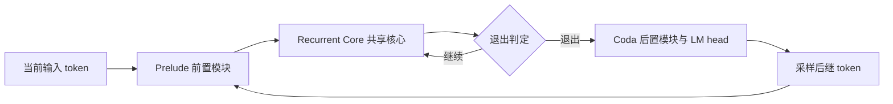

# Notes
> [!note] Depth-adaptive inference
> looping a block of shared layers a variable number of times.
> less compute for "easy" tokens and more for "hard" ones. 
> **So**, what is depth-adaptive?
> 对每个 input token 的某一个 shared layer，我们可能循环不同次数.


> Modern attention layers reduce KV-cache memory footprint, and native multi-token prediction enables **self-speculative decoding.**

- facing the Hardware **constraints**

- Looped language models 很少从推理角度（inference perspective）受到关注

> [!tip] Challenge
> **tokens** with different numbers of loops cannot share a uniform forward pass and therefore cannot be handled by standard batching
> - **Solution**
> - CDB (*continuous depth batching*
> 	- 这是啥？ a depth-wise scheduler.

- 但话又说回来了，引入CDB 也提升了复杂度。

- We introduce the first end-to-end CDB implementation.
	- Looped LMs 在共享核心 (shared core) 之外，有着仅运行一次的边界阶段。且必须和不断变换的循环批次一起调度。
	- prelude 在token 进入loop 前处理每个token，coda 在其退出后预测下一个token
	- 用于重填已释放批次槽的新token 也不能直接获得。退出序列的下一个词元需要经过coda 和prelude
	- 退出决策只有在循环步骤完成后才可用，所以**调度器**无法提前准备下一个 recurrent batch
		- **GPU** idle
- 将**预填充**、prelude 和coda *batches* 和 loop steps 交错进行，

> [!important] 重填充很重要
> refill is important, especially in the memory-bound regime and for fully looped models.


- Problem Setup
	- looped-LM
		- a prelude $P_{\theta}$, a shared recurrent core $R_{\theta}$, and a coda $C_{\theta}$. 
		- For token $t$, the recurrent core runs $r_{t}\leq r_{\max}$ times, while the prelude and coda each run once.
	- **denote**: `prelude-core-coda`
		- example: a `0-4-0` model has no transformer layers outside the core. Its boundary stages (i.e., prelude and coda) only contain the embedding layer and LM head.
			- in this case, after each loop, use an exit criterion determines whether the token stops looping.
	- **Problem**: 引入自适应深度 (adaptive depth) 会导致
		- an exited token must run the code while the remaining tokens may require *another loop step*
			- -> the CDB scheduler must operate *within* the forward pass by tracking each token's loop progress individually and **routing** tokens between **stages** as they exit.


- **CDB** 不改变 prediction


# Depth-adaptive Inference of Looped Language Models via Continuous Depth Batching

中文：**通过连续深度批处理实现循环语言模型的深度自适应推理**。

> [!abstract] 一句话记住
> **少做循环只保证减少计算量，不保证 GPU 更快。** 本文用 CDB 在循环之间重新合批，并联合处理边界模块、KV 缺口和 CPU/GPU 依赖，让逐 token 自适应深度尽可能兑现为真实加速。

原文：[论文在线版本](https://arxiv.org/abs/2608.09444)（精读依据为本地保存的 28 页审稿版，以下页码以该版为准）。文件标注匿名、ICLR 2027 在审，不能把它写成已录用论文。“首次端到端实现”“接近最优”均为作者在该设置下的主张。下文页码为 PDF 页码，与正文页脚一致；**论文结果、解释、个人推演**分别标明。

## 1. 先把三个层次分开

| 层次                    | 问题                    | 对应对象                          |
| --------------------- | --------------------- | ----------------------------- |
| 推理能力 reasoning        | 怎样分步骤解决题目？            | CoT、反思、解题策略                   |
| 模型架构 architecture     | 每个 token 的内部计算怎样组织？   | Looped Transformer、共享循环核心、退出门 |
| 推理系统 inference system | 多请求怎样**高效运行**在 GPU 上？ | batching、KV 管理、内核、调度、CDB      |

本文主要在第三层工作，但需要第二层配合。这里的循环模型确实是 Looped Transformers，实验模型为 **Ouro 1.4B** 和 **Huginn 3.5B**。联系 [[looptransformer知识基础]]：Universal Transformer 提供“沿深度循环及可选动态停止”的架构思想；本文追问这种**动态深度**怎样高效部署。

理解区别：CoT 延长生成的 token 序列；深度循环增加预测 token 前的内部迭代。二者可以结合，本文附录的 GSM8K 评估也采用 CoT 任务配置。每生成一个 token 再次调用整模型，是自回归生成的常态；Looped 特指**预测一个 token 的内部重复共享模块**。

## 2. 问题设定：哪些计算可以省？

### 2.1 Prelude–Core–Coda



每个 token 各运行一次 $P_\theta$ 和 $C_\theta$，循环核心 $R_\theta$ 运行 $r_t\le r_{\max}$ 次。

| 模型 | 物理层分割 | 所测最大循环 | 有效 Transformer 深度 |
|---|---|---:|---|
| Ouro 1.4B | 0–24–0，fully looped | 4 | $24r_t$，最大 96 |
| Huginn 3.5B | 2–4–2，middle looped | 16 | $2+4r_t+2$，最大 68 |

**0–24–0 不是没有边界计算**：仍有 embedding 与 LM head。Huginn“50% 的层在核心之外”指 4/8 个**物理层**，不代表它们占一半实际计算量，因为核心会被重复执行。Huginn 训练时循环 32 次，本文取 16，理由是其所测准确率在 16 以上基本持平。[§2、§6.1、附录 F.2；pp.2–3、6–7、27]

### 2.2 为什么标准 Continuous Batching 不够？

标准 CB 以完整的一步 token 解码为调度单位。本文的基线让每个 token 都循环 $r_{\max}$ 次；自适应深度则让一些 token 进入 Coda，另一些继续 Core，同批不再执行统一路径。

本文指出三个问题：

1. **阶段异构**：Prefill、Prelude、Core、Coda 的频率和批大小不同。
2. **KV 缺口**：历史 token 提前退出后，没有更深循环的 KV。
3. **退出依赖**：下一批次依赖刚完成的一步的退出结果，CPU 处理时 **GPU 等待**。
	1. 这样就会浪费时间

> [!note] 我的理解
> 只有共享权重不够。需要同时解决“谁准备好运行哪一步”“注意力读取哪个历史状态”“何时才能知道下一批成员”这三个问题。[§2；p.3]

## 3. 核心方法一：跨深度合批与补位

### 3.1 参数共享使不同深度可以执行同一次 Core

同一 GPU Core 批次可以包含：A 请求的第 1 次循环、B 的第 4 次循环、C 的第 2 次循环。它们执行相同权重，各自携带独立隐藏状态、位置和 KV 元数据。

这只合并**已经就绪的工作**，并未让同一序列的后继 token 越过自回归依赖。普通 Transformer 不同深度对应不同权重，不能直接按这种方式合批。[§3、附录 A.4；pp.3、19]

### 3.2 Refill 与 No-refill

| 模式 | token 退出后做什么？ | 主要权衡 |
|---|---|---|
| No-refill | 移出 Core 批次；等这一群 token 全退出后一起过 Coda | Core 批次变小，但边界合批高效 |
| Refill | 尽早运行 Coda → 采样 → Prelude，将后继 token 插回 Core | Core 更满，但可能频繁运行小边界批次 |

不能直接拿新 token 补位：未完成序列必须先过 Coda/Prelude，新请求要先做 Prefill。系统用四类阶段队列拆开这些依赖。

**补位优先级**：达到阈值的 Coda 优先，其次是可准入的 Prefill，否则 Core；Prelude 紧接 Coda 或 Prefill 执行。最小 Coda 批量 **$K$** 防止每退出一个 token 就执行一次昂贵的边界模块。

- $K$ 小：尽快补位，Core 大，但边界批量小、调用频繁。
- $K$ 大：边界合批更高效，但延后补位，Core 暂时缩小。
- 原文配置：Ouro $K=1$；Huginn $K=\lfloor W/4\rfloor$，$W$ 是最大活动序列数。后者是实验经验，不是普遍定律。


**图 2 怎么读**：原有 $B=64$，退出 1 个。$K=1$ 立即为这 1 个跑边界，Core 补回 64；$K=16$ 先用 63 继续，等累计更多退出再跑边界；No-refill 等全部退出才统一处理。右边同时展示两种 KV 复用布局。[§4.1；p.4]

## 4. 核心方法二：给缺失的 KV 规定含义

### 4.1 缺口从哪里来？

假设前序 token $x_1$ 循环 2 次就退出，当前 $x_2$ 要循环 4 次。第 4 次注意力若按深度读取历史，就会需要根本没生成的 $KV_{x_1}^{(4)}$。

### 4.2 三种布局的差异

| 布局                   | 每个循环层、每 token 槽数 | 更深循环读取什么？        | 含义                |
| -------------------- | ---------------: | ---------------- | ----------------- |
| Depth-indexed        |       $r_{\max}$ | 对应深度的 KV         | 全深度时完整；提前退出留下缺口   |
| Last-exited          |  按实际执行保留，或仍预留全部槽 | 缺失深度读取最后实际计算的 KV | 处理提前退出；可释放不用的槽    |
| Shared / single-slot |                1 | 所有深度读同一槽         | 每轮覆盖；显存最省，但改变缓存语义 |

Last-exited 有两种实现：

1. **指针复用并释放槽位**：跳过深度指向最终 KV，释放未用槽；定制 Triton 内核，页大小 1。
2. **物理复制**：将最终 KV 复制到跳过的槽，不节省显存；实现简单、保留原注意力后端，复制可用独立 CUDA stream 重叠。

固定最大批大小且显存够时，两者吞吐差别小；显存限制 batch 时，释放槽位可以容纳更多请求，才产生额外吞吐收益。[§4.2、附录 B；pp.4、21–22]

> [!warning] 共享参数 ≠ 无损共享 KV
> 不同循环的隐藏状态不同，产生的 K/V 也不同。共享 KV 是需要验证的模型能力，不是参数共享的自动推论。Last-exited 复用同样不是对原本缺失深层状态的精确重建。

### 4.3 显存公式

若循环外注意力层数为 $\ell_0$、核心层数为 $\ell_r$、每个核心层保留 $s$ 份 KV，则每 token 缓存条目数为

$$N_{KV}=\ell_0+\ell_rs.$$

相对全深度索引缓存，节省倍数为

$$\frac{\ell_0+\ell_rr_{\max}}{\ell_0+\ell_rs}.$$

单槽共享时，Ouro 为 $96/24=4$ 倍；Huginn 为 $68/8=8.5$ 倍。边界层 KV 不循环共享，因此不能直接把 Huginn 总缓存节省写成 16 倍。[附录 F.1；pp.25–26]

## 5. 核心方法三：Lookahead Gate 隐藏调度延迟

### 5.1 为什么仅异步不够？

即时门在 Core 第 $r$ 步完成后才决定谁进入 $r+1$。CPU 要读回门结果、组批和传输数据，GPU 下一步依赖这些工作，无法靠简单异步消除。

前瞻门让第 $r$ 步的信号决定是否参加 **$r+2$**；CPU 可利用 GPU 执行 $r+1$ 的时间准备后续批次。

```text
即时决策：GPU 跑 r → CPU 读结果并组批 → GPU 跑 r+1
前瞻决策：GPU 跑 r+1 的同时，CPU 用 r 的信号准备后续批次
```


图 3 设备空闲比例：同步 10.27%；异步 + 即时门 10.05%；异步 + 前瞻门 0.56%。**瓶颈是依赖，不是把函数标成异步就能解决。** [§4.3；p.5]

### 5.2 有没有多算一轮？

不能把它理解为原即时门决定退出后无条件多跑一轮。Ouro 在冻结主模型后蒸馏训练前瞻门，学习提前预测未来退出；Huginn 使用延迟的收敛规则并重校准阈值。

附录 F.2 报告：前瞻门与教师门的准确率、退出曲线接近；在循环前一次预测完整退出深度的门表现较差。两种“提前预测”不能混为一谈。

约束：学习型前瞻门最小循环数 2；收敛准则比较两个相邻状态，加调度延迟，最小循环数 3。这可能不利于一次循环就能输出有效结果的浅循环模型。[附录 F.2；p.27，图 17 p.28]

## 6. 精读公式：FLOPs 与实际时间之间隔着什么？

### 6.1 Decode 的计算比值

令 $F_0$ 为一次 Prelude/Coda 的固定 FLOPs，$F_r$ 为一次 Core FLOPs，平均退出深度

$$\bar d=\frac1T\sum_{t=1}^T r_t.$$

则论文的 FLOPs 加速估计为

$$S_{dec}=\frac{F_0+r_{\max}F_r}{F_0+\bar dF_r}\le\frac{r_{\max}}{\bar d}.\tag{1}$$

**推导**：分子是固定全深度每 token 计算，分母是自适应平均计算。只有边界成本可忽略时，才接近循环次数之比。边界越重，越接近 1。[§5；p.5]

### 6.2 Prefill 是不能忽略的固定部分

设基准时间中未被优化的 Prefill 占比为 $\alpha$，则 Amdahl 式估计为

$$S_{e2e}=\left(\alpha+\frac{1-\alpha}{S_{dec}}\right)^{-1}.\tag{2}$$

**辅助例子，非论文测量**：$F_0=2,F_r=4,r_{\max}=4,\bar d=2$，则 $S_{dec}=18/10=1.8$；若 $\alpha=0.3$，端到端估计只有 $1/(0.3+0.7/1.8)\approx1.45$。

长输入使 Prefill 占比更大，因此只优化 Decode 的方法，端到端提升会被稀释。[§5、§6.2；pp.5、7–8]

### 6.3 延迟模型解释何时补位

为避免原文 $\alpha$ 符号重用，此处用 $a$ 表示 KV 读取系数：

$$t(N_c,N_b)=\delta+\gamma N_b+aN_c.$$

- $\delta$：单次核心权重重载的固定成本。
- $N_b$：批内当前 token 数；$\gamma N_b$ 是随批次增长的计算成本。
- $N_c$：读取的历史 KV 条目数；$aN_c$ 是 KV 流式读取成本。

等长上下文 $L$ 时，$N_c=BL$、$N_b=B$，有

$$t(B)=\delta+(\gamma+aL)B,\qquad B^*(L)=\frac{\delta}{\gamma+aL}.\tag{4}$$

$B^*$ 是固定成本与随 batch 增长成本相等的尺度，可理解为转折量级，不是越过后立刻完全饱和的硬阈值。

| 区域 | 缩小批次的效果 | Refill 为什么有用？ |
|---|---|---|
| 固定权重加载主导 | FLOPs 减少，但延迟变化小 | 填入新工作只增加少量延迟，提高每次权重加载产出 |
| 随 batch 增长的成本主导 | 批次变小可更明显省时 | No-refill 已能利用退出，补位额外收益缩小 |

原文将后者概括为 compute-bound，但模型也包括 KV 带宽项；不能把它理解为所有长上下文都只受算力限制。上下文越长，$aL$ 越大，$B^*$ 越小。[§5、附录 C；pp.6、22–23]

附录通过 $\tau(r)=\tau_0+\tau_rr$ 分离边界与单次循环成本，$R^2\ge0.999$。Ouro 边界约 0.4 ms，Huginn 约 2.8–3.3 ms。核心参数量并不足以决定加载成本：Huginn 的 4 个宽层约 1.6B 参数，$\delta\approx2.3$ ms；Ouro 的 24 个窄层约 1.2B，$\delta\approx5.4$ ms。[附录 C；pp.22–23]

## 7. 实验设计与证据链

### 7.1 必须一起读的实验控制

- 单张 80 GB H100；主模型为 Ouro 1.4B 与 Huginn 3.5B。
- CB/CDB 使用同代码库、内核与准入规则；基线是全深度 CB，不是任意现成部署的默认速度。
- 默认 $W=64$，长输入 ArXiv 多处取 8；$M=8192$；bfloat16、分页 FlashAttention-3、CUDA graphs。
- Prefill 始终全深度，提前退出只用于 Decode。
- 主吞吐实验 **CB/CDB 都采用单槽共享 KV**，以覆盖更宽的可测 batch 范围。
- 参考响应长度决定何时停止，忽略 EOS；事先记录退出深度并回放。调度器看不到未来信息，门仍运行、计入开销，但决策被回放记录覆盖。

回放控制有助于比较调度器，不能直接替代开放式自由生成质量的验证。[§6.1、附录 A、D；pp.6–7、16–20、23–24]

| 工作负载 | 平均输入/输出 token（Ouro tokenizer） | 测什么？ |
|---|---:|---|
| Alpaca | 18 / 60 | 短指令，Prefill 比例低 |
| ShareGPT | 267 / 311 | 聊天、长尾长度 |
| ArXiv | 6,989 / 370 | 长提示词，Prefill 重 |

### 7.2 结果回答了哪些问题？


| 论文结果                                 | 支持的结论                   | 原文定位            |
| ------------------------------------ | ----------------------- | --------------- |
| Ouro Refill 为 CB 的 1.32–1.53×        | 轻边界模型可有效利用补位            | §6.2，p.7，图 5    |
| Huginn No-refill 为 1.30–1.37×        | 边界重时，不补位可能更优            | §6.2，p.7        |
| 加速比为估计 $S_{e2e}$ 的 96%–99% / 83%–96% | 在给定退出行为下，系统接近该估计参照      | §6.2，p.7        |
| 无提前退出时保留 CB 吞吐的 95%–99%              | 分阶段和调度额外开销较低            | §6.2，p.7        |
| Prefill 占 GPU 时间 3.7%–36%            | Decode FLOPs 比值会高估端到端收益 | §6.2，pp.7–8     |
| 在线延迟曲线在更高请求率才陡升                      | 吞吐收益转为更高服务容量            | §6.3，p.8，图 6    |
| 移除 Huginn 边界层后，立即补位更有利               | 边界成本是补位效率的重要原因          | §6.4，pp.8–9，图 7 |

在线采用十分钟泊松到达轨迹，报告端到端时间除以输出长度；不能由此直接推断 TTFT 或 p99 尾延迟的改善。

### 7.3 99% 的分母是什么？

> [!warning] 不是“快了 99%”
> 它比较的是实测加速比与估计最大加速比。例：$1.50/1.52\approx98.7\%$；若比较额外收益，则是 $(1.50-1)/(1.52-1)\approx96.2\%$。两者不同。

这也是依赖计算比值、测得 Prefill 比例及所测设置的**估计参照**，不是对所有硬件和调度算法的全局最优证明。

## 8. 最重要的准确率限制：附录 F 不能跳过

### 8.1 主吞吐设置不等于质量保持设置

表 4，固定深度 GSM8K、flexible match、贪心解码：

| KV 布局 | Ouro $r=4$ | Huginn $r=16$ |
|---|---:|---:|
| 完整深度索引 | 78.09% | 30.93% |
| 单槽共享 | **0.23%** | 32.52% |
| 首轮独立、后续共享 | 72.40% | 32.83% |


**事实**：作者无法复现 Ouro 原工作接近无损共享的结果。是否仅在 Decode 共享、Prefill 保留深度索引，被讨论为可能原因，未最终确认。

**判断**：主吞吐对比仍可说明在匹配布局/工作负载下调度的收益，但不能直接宣称“Ouro 保持原准确率并得到该速度”。应在同一配置中联合验证准确率、退出行为、延迟和显存。Last-exited 在匹配条件下有类似速度收益，说明 CDB 并非必须使用单槽共享；但实际部署仍需单独验证其质量。[§6.1、附录 B、F.1；pp.7、21–22、25–26]

### 8.2 自适应深度与前瞻门的质量证据

图 17 报告自适应深度的质量—平均深度曲线优于固定截短循环。Ouro 平均深度低至约 2.5、Huginn 约 8 仍表现较好；前瞻门/延迟收敛经相应训练或重校准后，与原门曲线接近。这是所测任务、模型与设置下的经验结果，并非对任意门的精确等价保证。[附录 F.2；pp.27–28]

## 9. 我的评价：贡献边界与尚未回答的问题

### 9.1 最有价值的贡献

1. 把已有 CDB 思想推进到含 Prefill、边界、调度和 KV 更新成本的端到端实现。
2. 用异步前瞻门解决细粒度调度的关键路径。
3. 将模型分层、退出分布、缓存布局与硬件效率放到同一框架分析。

### 9.2 不能从论文直接推出的结论

- 不是自适应深度在所有质量/负载条件下都快。
- 不是完全循环架构在匹配训练成本与准确率后总胜过 middle-looped；循环外层可能提高质量。
- 不是更多循环一定更好；需要兼顾表达能力、训练计算和调度粒度。
- 不是单槽共享普遍无损，也不是 Ouro 永远不能共享；需要查明设置和训练的影响。
- 不是生产部署全功能评测：只有两种主架构、单 H100，没有多卡、生产抢占、prefix caching、推测解码等综合实验。
- CDB 的调度目标是执行既定计算；本文为异步执行适配的门只做到经验上接近原门，不能笼统说所有改动严格不影响输出。

## 10. 对自己研究的启发与实验草案

以下是**个人推演，论文尚未验证**。

| 方向 | 可检验假设 | 最小实验 | 必须控制 |
|---|---|---|---|
| 动态 $K$ | 固定 $K$ 不适配变长上下文和到达率 | 固定策略 vs 依据队列/阶段耗时切换 | 相同退出与质量、尾延迟 |
| 边界协同设计 | 边界质量增益可能抵不过补位代价 | 比较 0–k–0、1–k–1、2–k–2 | 训练预算、目标质量、总显存 |
| KV 共享感知训练 | 训练适配可缓解共享后的质量损失 | 固定模型与共享适配模型对比 | Prefill/Decode 布局分别列出 |
| 延迟感知退出门 | 最小平均深度不必最小真实耗时 | FLOPs 惩罚 vs 服务延迟代理目标 | 质量和工作负载分布 |
| 浅层提前退出 | 入口仅预测一轮退出比预测全部深度容易 | 入口局部门 + 后续前瞻门 | 预测误差、额外计算、质量 |

**建议先做的实验**：选一个在目标 KV 布局下质量可用的小循环模型；比较全深度 CB、较浅固定深度 CB、CDB No-refill 和 Refill。再扫描上下文长度、$W$ 与 $K$。记录准确率、平均循环数、tokens/s、显存、Core/Coda 平均 batch、GPU 空闲率；在线再记录 TTFT、平均及 p95/p99 延迟。

目标图是**相同质量下的延迟/吞吐前沿**。如果只报平均循环和 FLOPs，无法区分收益来自少算、显存释放、权重复用还是调度重叠。

## 11. 阅读导航与自测

| 原文位置 | 阅读目标 |
|---|---|
| §2、图 1；pp.2–3 | 明确逐 token 自适应深度的三个系统难题 |
| §4.1–4.2、图 2；pp.3–4 | 画出阶段队列，手推补位及 KV 读取 |
| §4.3、图 3；p.5 | 画出即时门和前瞻门的依赖时序 |
| §5、附录 C；pp.5–6、22–23 | 推导 $S_{dec}$、$S_{e2e}$、$B^*$ |
| §6.1 + 附录 D；pp.6–7、23–24 | 检查缓存布局、回放、停止条件和基线 |
| 附录 F.1–F.2；pp.25–28 | 将速度结论放回质量条件中 |
| 附录 A；pp.16–20 | 实现参数、调度伪代码、CUDA graphs |

- [ ] 能否解释“少算 FLOPs，但延迟没减少”？
- [ ] 为什么不同循环深度的 token 可以放进同一个 Core batch？
- [ ] 为什么空位出现后不能立即得到可补入的新 token？
- [ ] 历史 token 只循环 2 次，后续 token 到第 4 次时读哪份 KV？
- [ ] 第 $r$ 步的前瞻信号控制哪一步的参与？为什么？
- [ ] 为什么 Huginn 的 KV 节省是 8.5 倍，而不是 16 倍？
- [ ] “99%”的分母是什么？与准确率有什么关系？

> [!summary] 最后留下的认识
> 深度自适应是一种模型能力；让它获得真实加速，需要模型架构、退出策略、缓存语义与服务调度共同设计。评价时必须同时检查质量、实际时间和显存。
